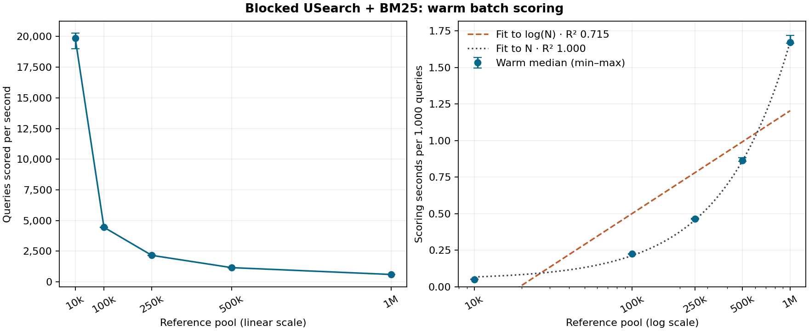

# Blocked USearch + BM25 scaling

One editable [reference](reference.yaml), copied from `1Mx1M_usearch/warm`, drives all five points. Only dataset paths, isolated caches/outputs, job labels and an optional encoder device override change. Keep a separate reference for an experiment (e.g. remove BM25 and renormalize the remaining scoring weights), then pass it with `--reference`. Use the same inputs and seed across experiments.



## Measured on 2026-11-22

M1 Ultra Mac Studio (20 physical cores, 64 GiB), macOS 26.7.3. Default-feature locked release at `446d45e`, CPU preparation, MiniLM, 12 encoder slots, batch size 256, `RAYON_NUM_THREADS=20`, `ORT_NUM_THREADS=2`. Country blocking, name/address embeddings and BM25, synonym scoring, ANN 50, BM25 10, top 5, default graph assignment. Each size starts with empty vector caches. Three subsequent serial runs each start a new process, reuse both indexes and rebuild the in-memory BM25 index. Each run gets fresh outputs and CrossMap. Logs confirm both vector-cache hits and the BM25 build in every warm trial.

| Reference pool | Mean country block¹ | Median queries scored/s | Scoring seconds / 1,000 queries | Median whole process, s |
|---:|---:|---:|---:|---:|
| 10k | 500 | 19,881 | 0.050 | 1.607 |
| 100k | 5,000 | 4,447 | 0.225 | 5.088 |
| 250k | 12,500 | 2,157 | 0.464 | 10.894 |
| 500k | 25,001 | 1,155 | 0.866 | 20.595 |
| 1M | 50,001 | 598 | 1.672 | 40.707 |

¹ Weighted by the country distribution of the fixed 10,000 queries. Nested reference samples and the independent query sample preserve country proportions and original row order. The available true matches can change as the pool grows. This is not an accuracy benchmark.

[All 20 measurements](measurements.csv), including prime runs. Chart uses only warm medians, with min–max bars. The CLI scoring timer excludes index preparation, graph solving and output. Seconds per 1,000 is 1,000 / aggregate throughput, **not** single-query latency. For the five medians, an ordinary least-squares fit of that cost to `a + bN` gives R² = 0.9997 versus 0.7145 for `a + b log(N)`. This describes the observed range, not asymptotic complexity. Eligible block size increases proportionally to pool size: indexed retrieval doesn't eliminate the work of handling eligible IDs. These timings do not isolate the individual indices. Repeat with BM25 removed for a controlled comparison.

## Repeat

From repository root, with Python 3.11+, PyYAML, matplotlib and NumPy:

```sh
cargo build --locked --release
RAYON_NUM_THREADS=20 ORT_NUM_THREADS=2 python3 benchmarks/batch/usearch_scaling/run.py \
  --binary target/release/meld --out /tmp/melder-scaling-new --encoder-device cpu
python3 benchmarks/batch/usearch_scaling/plot.py /tmp/melder-scaling-new/measurements.csv /tmp/melder-scaling-new/scaling.png
```

`--out` must not exist. Override `--a`, `--b`, `--sizes`, `--queries`, `--seed`, `--repeats` or `--reference` as needed. Point input arguments at the original generated million-row CSVs (not separate size-specific fixtures). The runner retains generated YAML, sampled CSVs, raw logs, crossmaps, outputs, metadata and index caches in the private run directory. Input SHA-256: A `5e3c7d6048bf1acfd997e6f66658ece8636d033ff89e7efc6d2f1c28bad51c86`, B `6e619fb000bb1e9ff083cc471ea6fafa4a68429c2c1b47849370aa4a06c28eba`; measured binary `c1dd9dd739e0a34d39f90db22d76ea94cde57b5bab413433c46a0ad7c6c8c0d7`.
