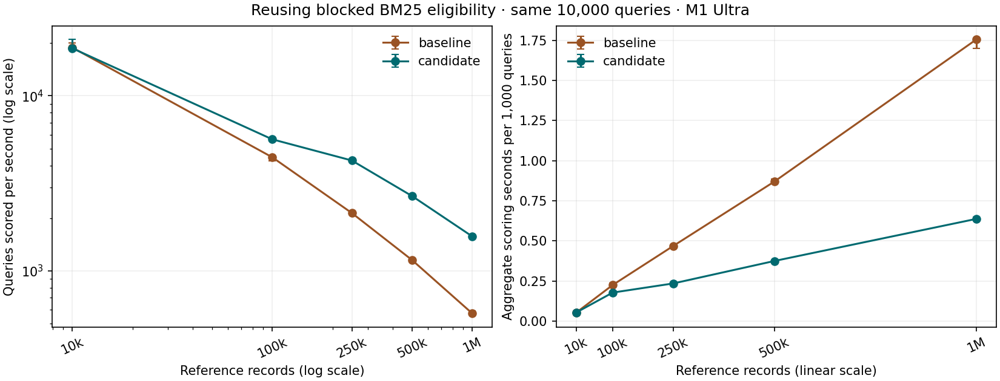

# What helped: reuse blocked BM25 eligibility; don't add an exact index

M1 Ultra Studio, 20 cores, 64 GiB, macOS 26.7.3; default-feature locked Rust release, CPU, 20 Rayon threads, `ORT_NUM_THREADS=2`. Fixed seed 42, 10,000 identical B queries, nested stratified A samples, original 1M USearch + BM25 recipe. Compare immutable `446d45e` to the branch using three alternating pairs per size/recipe. Each invocation gets a private warm index clone and fresh outputs. All rates below are medians, in **queries scored/s**, excluding startup, index building, graph assignment and export. Process wall and process peak RSS include those phases. No claim about live/enroll throughput or general algorithmic complexity.

## Block reuse

| A records | Original → optimized, original recipe | Ratio | Original → optimized, added exact LEI | Peak RSS MiB, original recipe | Whole process seconds, original recipe |
|---:|---:|---:|---:|---:|---:|
| 10k | 18,884 → 18,706 | 0.99× | 19,861 → 19,642 | 1,451 → 1,473 | 1.66 → 1.68 |
| 100k | 4,453 → 5,641 | 1.27× | 4,444 → 5,614 | 2,350 → 2,340 | 5.16 → 4.67 |
| 250k | 2,137 → 4,268 | 2.00× | 2,124 → 4,229 | 3,882 → 3,883 | 11.11 → 8.58 |
| 500k | 1,151 → 2,673 | 2.32× | 1,152 → 2,685 | 6,387 → 6,383 | 20.57 → 15.45 |
| 1M | 570 → 1,571 | **2.76×** | 587 → 1,566 | 11,327 → 11,324 | **42.06 → 29.98** |

The original recipe has no exact scoring field, so its improvement does not come from exact scoring. At 1M the baseline profiler spent **218 of 312 summed BM25 worker-seconds** constructing numeric membership; retrieving the block IDs cost a further **32 worker-seconds** outside BM25. Those are overlapping per-worker times, **not** 250 seconds of process wall. At 10k (small exhaustive blocks) the membership construction cost was zero. [Profile data](results/profile_worker_ns.csv) · [Disposable baseline instrumentation](profile_baseline.py).

The branch retains backend-supplied IDs for successful nonempty lookups, and numeric membership only above the existing exhaustive threshold. Bounded per batch (64 keys / 64 MiB estimated), no setting or persistent file. Racing first queries may do duplicate preparation; misses still work when the cache is full. At 1M, all 20 country blocks fit: **41.2 MiB estimated retained**. The similar process peak RSS does **not** mean the cache uses no memory. This is not a universal win for mostly distinct or oversized blocks.

**Correctness.** For all five sizes a validation-only [shadow build](shadow_gate.py) ran fresh backend lookup and uncached BM25 alongside cached retrieval on the *same immutable index*, with term order fixed for both evaluations. Across 50,000 queries, the block ID lists, top-k BM25 IDs/order and normalized scores agreed exactly. This is a correctness gate, not a timed run. Deterministic small/exhaustive and large/WAND end-to-end fixtures also passed on memory and SQLite. All 60 ordinary timing runs agreed on accepted pairs within each size/recipe. They did **not** give byte-identical results across independent processes: unmatched best scores varied, and some 100k review decisions varied. This also happens in baseline repeats; not every cross-arm delta lay inside the three baseline repeats' range. [Full decision comparison, including anomalies](decision_parity.md).

## Exact: optimize the comparison, not the candidate list

No config or matching-policy change. The production change is just an early return for empty fields or an unequal pair of ASCII strings after trimming. The existing ASCII comparison is conclusive in that case; previously it also allocated two lowercased strings. Non-ASCII pairs keep the existing whole-string lowercase semantics, including when a Unicode string lowercases to ASCII.

- **Isolated scorer:** over 12.8M comparisons per run, the allocation-free shortcut was **3.32×** faster on short codes, **2.34×** on LEIs, and **1.02×** on the Unicode fixture (three alternating pairs). No persistent key storage. Normalized strings, collision-verified hashes, and shared intern IDs also performed well when both sides were already prepared. On 100k long Unicode records, observed peaks were ~21.6 MiB uncached versus ~39.3/40.0/42.9 MiB respectively. These figures do not include all costs of integrating keys into a real pool. [Microbenchmark and trade-offs](../exact_probe/README.md).
- **Actual mixed job, exact change alone:** 18,520 → 18,795 at 10k; 4,279 → 4,279 at 100k; 575 → 575 at 1M. **No reliable end-to-end speedup.** In the separate wider 200-ANN-candidate exact stress recipe, 10k was 5,547 → 5,621; 100k was 6,198 → 5,181. The latter medians favor baseline; individual rates fluctuated substantially in both arms. Don't generalize the isolated scorer gains to job throughput.
- **Actual prepared-key prototype:** precomputing normalized ASCII pool values and preparing the query once, with Unicode fallback, made all nine paired jobs slower. At 1M mixed it cost **~224 MiB more peak RSS and 7.8% more wall time** (median paired wall ratio). Even the 100k wider-shortlist test took 7.4% more wall time. [Prototype patch, measurements, limits and parity](exact_integration/REPORT.md).

**Recommendation:** retain the small allocation avoidance; do not ship normalized-key, hash or intern indexes for exact scoring on this evidence. None of the experiments uses equality to generate new candidates. Revisit prepared keys if a *representative* workload spends significant time on repeated long Unicode comparisons and can amortize preparation over enough queries.

## Reproduction and raw evidence

[Runner](README.md) · [98 raw paired measurements](results/paired.csv) · [binary/input hashes](results/provenance.json) · [18 additional integrated prototype measurements](exact_integration/REPORT.md). `final-paired` compares the original release to the combined production changes. `exact-e2e` and `shortlist` use the same original binary and a release built from `446d45e` with **only** the `src/scoring/exact.rs` change. Ratios in the BM25 table are ratios of medians; the integrated prototype report explicitly labels paired statistics. Slight differences from the earlier scaling chart are why we measured contemporary controls. Regenerate this chart with `python3 benchmarks/batch/usearch_scaling/comparison/chart.py`.
