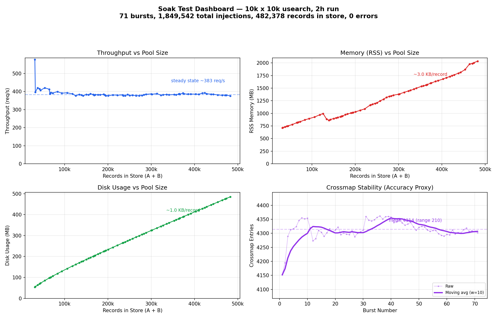

← [Back to Index](./) | [Configuration](configuration.md) | [Building](building.md)

# Performance

## Overview

Benchmarks on this page were run on two Macs. The **M1 Ultra Mac Studio**
is the reference machine for batch benchmarks: its extra CPU cores typically
help on larger jobs. The **M3 MacBook Air** is the reference machine for live
benchmarks: its faster individual cores typically help with the work done
for each request.

## Batch mode performance

`flat` scans all candidates linearly; `usearch` uses an HNSW
approximate nearest-neighbour (ANN) graph for O(log N) candidate
selection. Cold builds encode vectors from scratch and save them to
disk; every subsequent run is warm. Both backends use `country_code`
blocking.

10k x 10k means 10,000 records on each side with zero initial
crossmappings.

| | flat 10k x 10k | usearch 10k x 10k | flat 100k x 100k | usearch 100k x 100k |
|---|---:|---:|---:|---:|
| Index build time (no cache) | 5.5 s | 5.6 s | 51.1 s | 64.4 s |
| Index load time (cached) | 35.5 ms | 45.6 ms | 360.8 ms | 447.1 ms |
| Scoring throughput (warm) | 1,678 rec/s | **45,370 rec/s** | 182 rec/s | **31,094 rec/s** |
| Wall time (cold) | 11.507 s | 6.470 s | 538.145 s | 71.741 s |
| Wall time (warm) | 6.510 s | 0.787 s | 553.018 s | 6.471 s |

Measured on the M1 Ultra with default graph assignment and CPU encoding
using `all-MiniLM-L6-v2`, `encoder_pool_size: 4`, and the default CPU
`encoder_batch_size: 64`. Index timings cover both datasets; build time
includes encoding but excludes saving the cache. The
10k and warm 100k figures are medians of three runs; each cold 100k figure
is from one run.

> [!TIP]
> The first build of cached indices for large datasets can be slow —
> vector encoding is compute-intensive. If this is a problem, set
> `quantized: true` in the `performance` section to roughly double
> encoding speed. Thereafter, pre-built indices on disk are reused
> and startup is fast.

- The `flat` backend is file-based with O(N) search performance. Use
  only for small experiments and development, or when building without
  C++ dependencies (`--no-default-features`).
- The `usearch` backend is an in-process HNSW vector database with
  O(log N) search. Enabled by default — use for any real-world workload.

## Batch graph optimizer

For a step-by-step explanation of how the two strategies choose pairs, see
[Graph versus greedy in Batch Mode](batch-mode.md#why-graph-assignment-is-the-default).

One end-to-end **1M × 1M blocked BM25** comparison on an **M3 MacBook Air**
used in-memory record storage and known correct pairs:

| Assignment | Correct fixture pairs | Wall time |
|------------|----------------------:|----------:|
| Optimized greedy | 456,571 | 61:45 |
| Graph / approximate | 498,162 | 63:09 |

Graph found **41,591 more correct pairs** for **1 min 24 sec** of additional
wall time. This was one run per strategy on one fixture, not a general
accuracy or runtime guarantee.

For solver-only results, see the [prototype comparisons](../benchmarks/assignment_solver/approx-results.md),
[cutoff study](../benchmarks/assignment_solver/cutoff-results.md), and
[exact scaling tests](../benchmarks/assignment_solver/results.md).

## GPU-accelerated batch encoding

The `gpu-encode` build can run batch inference through CoreML on macOS
or CUDA on Linux. On the M1 Ultra, using CoreML did not shorten the
full index build compared with the standard CPU release.

### Encoding throughput (M1 Ultra, 20 CPU cores, 64 GPU cores, 64 GB)

Each run started with empty caches and built both USearch indexes: one
million records per side, encoding name and address with all-MiniLM-L6-v2.
The rate is **two million records divided by the combined build time**.
It includes encoding and inserting vectors into the indexes, but excludes
cache saves and matching. Each full-scale setting was measured once.

| Build and device | Encoder slots | Batch size | Records/s | Measured A+B build time |
|---|---:|---:|---:|---:|
| Standard CPU | 1 | 64 | 435 | 76 min 36 s |
| Standard CPU | 8 | 64 | 920 | 36 min 14 s |
| **Standard CPU** | **8** | **128** | **931** | **35 min 48 s** |
| CoreML | 8 | 256 | 827 | 40 min 18 s |
| CoreML, experimental thread cap | 12 | 128 | 905 | 36 min 50 s |

The two finalists were chosen on smaller samples. At 64k records per side,
CoreML led on throughput (1,887 vs 1,561 records/s, median of two runs each).
At full scale they finished about one minute apart. The older ~18-minute
GPU figure was a projection, not a measured build time.

<a id="optimal-gpu-settings-by-pool-size"></a>

### Measured GPU settings by pool size

These are full 1M × 1M builds with CoreML and Homebrew ONNX Runtime 1.31.1.
The first seven rows use the GPU-enabled release with its default CPU
thread count. The last row uses an experimental build that limits each
encoder session to two CPU threads; this is **not a YAML setting**.

| Encoder slots | Batch size | CPU threads per session | Records/s |
|---:|---:|---|---:|
| 4 | 256 | Default | 754 |
| 8 | 256 | Default | **827** |
| 12 | 128 | Default | 758 |
| 12 | 256 | Default | 735 |
| 12 | 512 | Default | 610 |
| 16 | 128 | Default | 665 |
| 16 | 512 | Default | 255 |
| 12 | 128 | 2 (experimental) | **905** |

For this Mac and workload, **8 slots and batch size 256** was the fastest
CoreML configuration tested without modifying the release. More slots or
larger batches did not consistently help. For another machine or model,
use a small sample to select candidates, then check them at the intended
dataset size.

See [Building: GPU encoding](building.md#gpu-encoding) for setup
instructions and [Configuration](configuration.md#performance-field-reference)
for the full field reference.

## Remote encoder throughput

When [`embeddings.remote_encoder_cmd`](remote-encoder.md) is set,
encoding runs out-of-process via a subprocess pool talking to your
organisation's central embedding service. Throughput is bounded by
`encoder_pool_size × (1 / remote_call_latency)` and is typically
50–200 req/s — an order of magnitude slower than local ONNX — because
every call pays a network round-trip to the central service.

This is by design: the remote encoder path exists to comply with
organisational constraints on AI components, not to improve
performance. If you have the option of running the model locally,
you will be faster with `embeddings.model`. See
[Remote Encoder](remote-encoder.md) for the full throughput discussion
and when each mode is the right fit.

## BM25-only batch mode

BM25 + fuzzy + exact scoring, `country_code` blocking. BM25 retrieves
its top candidates from the index before full record scoring. Large
eligible pools use WAND to skip documents that cannot beat the current
best candidates.

When blocking is disabled, batch mode searches the whole BM25 index
without constructing a per-query eligibility set. Small pools retain
exhaustive scoring; large pools retain WAND. The A-side ID list is
collected once and shared across batch queries, preserving the existing
shared scoring pipeline and flat-vector search behavior. This is selected
automatically from `blocking.enabled`; there is no new configuration.
Blocked searches and live/enroll behavior are unchanged.

With blocking enabled, batch can reuse a block's record IDs and, for large
blocks, its BM25 membership set across queries. At 1M reference records on the
M1 Ultra this raised warm scoring from 570 to 1,571 queries/s; at 10k there
was no measured gain. These are scoring rates, not end-to-end rates.
[Before/after runs, memory and parity checks](../benchmarks/batch/usearch_scaling/comparison/findings.md).

### Unblocked batch BM25 comparison

For each record in B, Melder uses BM25 to find possible matches in A.
With blocking enabled, the search can be restricted to records that share
a value, such as a country code. With blocking off, any record in A can
be a match. Earlier versions still built a list of all eligible A records
for every B record. Melder now searches the index without rebuilding that
identical list.

We tested two kinds of search. **Distinctive only** means that each A
record contains a term found nowhere else in A, such as `unique000000010`.
**Distinctive + common** keeps that term but adds the words `common shared`
to every A record and to every B record intended to match. Those two words
give BM25 more records to consider without helping it tell them apart.
In both tests, 900 B records contained a matching term. The other 100
contained only a term absent from A.

Each row shows the time to process **1,000 B records**. Throughput is
1,000 divided by that total time, including startup, index construction,
matching and CSV export. It is not the scoring-only rate printed by the CLI.

| Records in A | Search terms | Earlier time | Current time | Earlier B records/s | Current B records/s |
|---:|---|---:|---:|---:|---:|
| 10000 | Distinctive only | 0.517 s | 0.188 s | 1934 | 5319 |
| 10000 | Distinctive + common | 1.168 s | 1.111 s | 856 | 900 |
| 100000 | Distinctive only | 4.724 s | 0.568 s | 212 | 1761 |
| 100000 | Distinctive + common | 12.479 s | 8.561 s | 80 | 117 |

With 100,000 records in A, distinctive searches finished in **0.57 s
instead of 4.72 s**. Adding common words reduced the gain: the same job
took **8.56 s instead of 12.48 s**. Both versions returned the same
900 matched pairs and the same 100 unmatched B records in every run.

*Test conditions: M1 Ultra Mac Studio, four worker threads, default-feature
release builds `877f261` (earlier) and `3e3dc2f` (current). Both used
greedy assignment. Times are medians of three runs with fresh matching
files and warm operating-system and model caches.*

Reproduce with separate baseline and candidate release binaries:

```bash
python3 benchmarks/batch/unblocked_bm25/run_test.py \
  --baseline /path/to/baseline/meld --candidate ./target/release/meld \
  --pool-sizes 10000 100000 --queries 1000 --repeats 3 --threads 4 \
  --output /tmp/unblocked-bm25-comparison.json
```

The script preserves per-run logs and reports scoring/wall medians and
output equivalence. Every run uses a fresh crossmap and output directory.

### Blocked batch benchmarks

Here BM25 searches within a country rather than across all of A. For
example, when a B record has country code `GB`, BM25 looks for candidates
among the A records with that code. These tests use no embedding fields.

**How much difference does storage make?** We matched 10,000 B records
against 10,000 A records using the default graph assignment strategy.
Only the main record storage changes from memory to disk with SQLite;
Melder still uses memory to choose and export the pairs.

| Record storage | Total time | B records/s | Peak process memory | Accepted pairs |
|---|---:|---:|---:|---:|
| In memory | 0.760 s | 13,158 | 599 MiB | 6,092 |
| SQLite | 4.617 s | 2,166 | 148 MiB | 6,092 |

SQLite used about a quarter of the peak memory but took about six times
as long. As in the unblocked table, throughput is the number of B records
divided by the **whole job time**, from startup through CSV export.

**What happens at one million records per side?** We kept the records in
memory, asked BM25 for up to ten candidates per query, and compared two ways
to choose one-to-one pairs. Graph considers competing claims together;
greedy accepts eligible pairs as records are processed.

| Assignment | Total time | B records/s | Accepted pairs |
|---|---:|---:|---:|
| Graph (default) | 18 min 29 s | 901 | 657,119 |
| Greedy | 18 min 32 s | 899 | 645,954 |

Both jobs finished in about eighteen and a half minutes. Graph accepted
11,165 more pairs. That is a difference in the number accepted, not a
count of additional correct matches; this benchmark did not verify their
identities.

*Test conditions: M1 Ultra Mac Studio, 20 CPU cores, default-feature
release build `3e3dc2f`, with all 20 worker threads available. Each run
started with fresh matching files; operating-system and model caches were
not cleared. The 10,000-record figures are medians of three runs. Each
million-record job ran once to completion; its time is not a projection.*

## Live mode performance

We started with 10,000 records on each side and sent 30,000 requests from
ten concurrent clients. The workload was set to 80% encoding: the remaining
updates changed only non-embedding fields. Live assignment used the default,
greedy. Figures are medians of three runs on an M3 MacBook Air on AC power,
with at least two minutes between runs. Request timings exclude startup.

| Metric | Flat, cold | USearch, cold | Flat, warm | USearch, warm |
|---|---:|---:|---:|---:|
| Requests/s | 740 | 1,093 | 731 | **1,166** |
| Median latency | 10.5 ms | 8.5 ms | 10.0 ms | 7.8 ms |
| 95th-percentile latency | 33.7 ms | 20.3 ms | 35.9 ms | 18.7 ms |

Cold and warm describe how the server starts. Building the indexes from
scratch took 12.6–13.4 s to reach readiness; loading saved indexes took
0.33–0.36 s. All requests completed without HTTP errors, but the flat
backend logged warnings that some candidates had missing vectors and
received an embedding score of zero. These timings do not compare match quality.

With 100,000 records per side and warm USearch indexes, ten clients sent
10,000 requests at **991 requests/s**. Median latency was 9.3 ms and
95th-percentile latency was 20.4 ms.

### SQLite live mode

We compared in-memory and SQLite storage using warm USearch indexes and
10,000 records per side. Each run started from the same seed records;
ten clients sent 10,000 requests with the same 80% encoding workload.

| Metric | In memory | SQLite |
|---|---:|---:|
| Requests/s | 1,214 | 903 |
| Median latency | 7.9 ms | 10.3 ms |
| 95th-percentile latency | 18.3 ms | 19.6 ms |
| 99th-percentile latency | 25.5 ms | 24.8 ms |

SQLite handled about 26% fewer requests per second. Its 95th-percentile
latency was slightly higher, but its 99th-percentile latency was slightly
lower. Both started from saved state in under a second: 0.36 s for the
in-memory server with cached indexes and 0.53 s for SQLite.

### Deferred acceptance performance

[Deferred acceptance](live-mode.md#deferred-acceptance) is off by default.
In the existing warm live benchmarks, leaving it off kept throughput
close to main. Turning it on roughly halved throughput.

| Workload | Assignment mode | Throughput | Request run time | p95 latency |
|---|---|---:|---:|---:|
| 10k × 10k, 3,000 requests | Off | 1,592 req/s | 1.89 s | 20.2 ms |
| | On | 785 req/s | 3.82 s | 23.6 ms |
| 100k × 100k, 10,000 requests | Off | 1,263 req/s | 7.92 s | 22.5 ms |
| | On | 574 req/s | 17.42 s | 30.3 ms |

Figures are medians of three runs per mode and workload on an Apple M3 with
16 GiB RAM: in-memory storage, USearch, 10 concurrent clients, and identical
starting cache bytes. Request run time excludes server startup and shutdown.
Startup time was essentially unchanged. All 117,000 requests completed without
errors.

With the feature off, the final pairings matched main in every run. With it on,
there were only one and six displacements per run at 10k and 100k, respectively.
The cost isn't limited to completed displacements: live mutations run one at a
time and automatic proposals are checked in both directions. The benchmark did
not measure how much cost came from each, or whether the resulting matches were
more accurate.

## Low-encoding-ratio performance

When fewer requests require encoding (40% instead of 80%), throughput
improves further: the text-hash skip optimisation means non-encoding
requests complete in under 1ms.

| Metric (40% encoding) | flat (c=10) | usearch (c=10) |
|--------|------------:|---------------:|
| Throughput | 890 req/s | **2,474 req/s** |
| p50 latency | 10.1ms | 2.4ms |
| p95 latency | 21.0ms | 11.1ms |

## Soak test — stability under sustained load

A 2-hour soak test validates that the live server remains stable under
continuous injection pressure: no memory leaks, no throughput
degradation, no scoring drift, and zero errors.

### Test setup

- **Hardware**: Apple M1 Ultra (20 cores, 64 GB RAM)
- **Base pool**: 10k x 10k records, usearch backend, `all-MiniLM-L6-v2`
- **Scoring**: embedding (0.55) + BM25 on address fields (0.40) + exact LEI (0.05)
- **Blocking**: AND on country_code/domicile
- **Concurrency**: 10 HTTP workers, `encoder_pool_size: 4`
- **Injection mix**: ~25% new records, ~75% upserts (embedding mutations,
  field-only mutations). New records are synthetic with no true match on
  the opposite side.
- **Sleep between bursts**: 10–60 seconds (randomised)

### Results summary

| Metric | Value |
|--------|-------|
| Duration | 2 hours |
| Bursts completed | 71 |
| Total injections | 1,849,542 |
| Final pool size | 482,378 (241k per side, up from 10k base) |
| Errors | **0** |
| Steady-state throughput | ~383 req/s |
| Memory growth | 714 → 2,035 MB (~3.0 KB per new record) |
| Disk growth | 54 → 485 MB (~1.0 KB per new record) |
| Crossmap entries | mean 4,314 (range 210) |

### Dashboard



All four charts show near-ideal behaviour:

**Throughput vs pool size** — after an initial burst at 577 req/s (small
pool), throughput settles at ~383 req/s and stays flat despite the pool
growing from 31k to 482k total records (a 15× increase). The AND
blocking strategy bounds scoring cost by block size rather than total
pool size, which is why throughput barely moves.

**Memory vs pool size** — linear growth at ~3.0 KB per new record with
no sign of a leak. Upserts to existing records do not grow memory. The
visible dip around 130k records is an OS-level artifact: macOS
aggressively compresses inactive memory pages during the sleep intervals
between bursts. When subsequent bursts touch those pages again (scoring
reads from the full pool), the OS decompresses them and RSS climbs back
to the trendline. This is not application behaviour — the underlying
allocations are unchanged.

**Disk vs pool size** — perfectly linear at ~1.0 KB per new record.
This covers the WAL (append-only event log), usearch HNSW index growth,
and crossmap CSV. No WAL bloat or runaway growth.

**Crossmap stability** — the crossmap tracks confirmed 1:1 match pairs
(A↔B). This chart is an accuracy proxy: if scoring were degrading under
load (e.g. due to index corruption, vector drift, or blocking index
inconsistency), the crossmap count would trend downward as upserts
break pairs that can no longer re-confirm.

The ~4,300 confirmed pairs come from the original 10k x 10k base data
that genuinely match. Synthetic new records are random and have no true
counterpart, so they almost never reach the 0.85 auto-match threshold.
What we observe is equilibrium: upserts with mutated fields temporarily
break existing pairs, re-scoring mostly re-confirms them, and the small
number that don't re-confirm are offset by occasional new pair
formation. The 10-burst moving average stays within 1.5% of the mean
across the full 2-hour run — no drift.

### Running the soak test

```bash
cargo build --release --features usearch
python3 benchmarks/soak/10kx10k_usearch/run_test.py --duration 2
```

Shorter runs for quick validation:

```bash
python3 benchmarks/soak/10kx10k_usearch/run_test.py --duration 0.5 --min-sleep 10 --max-sleep 60
```

Results are written to `benchmarks/soak/10kx10k_usearch/soak_log.csv`.
The server log is at `/tmp/meld_soak_<pid>.log`. The script cleans all
test artifacts (cache, WAL, crossmap, output, soak log) before each
run, but does not clean the `/tmp/` server log.

## Benchmarking

Each benchmark is a self-contained directory with its own `config.yaml` and
`run_test.py`. All scripts require only the Python standard library — no pip
dependencies.

### Running individual tests

```bash
# Single batch test — run from the project root
python3 benchmarks/batch/10kx10k_usearch/cold/run_test.py
python3 benchmarks/batch/10kx10k_usearch/warm/run_test.py

# Single live test
python3 benchmarks/live/10kx10k_inject3k_usearch/cold/run_test.py
python3 benchmarks/live/100kx100k_inject10k_usearch/warm/run_test.py
```

Cold tests wipe their cache and rebuild from scratch. Warm tests preserve the
cache — run them twice if the cache is empty: the first run builds it, the
second is the true warm measurement.

### Running the full suite

> [!WARNING]
> A full suite run takes a long time. The 100k cold tests alone encode
> 200,000 records through the ONNX model (~3.5 minutes each). Expect
> **45–60 minutes** for all batch tests and **60–90 minutes** for all live
> tests on Apple Silicon. Budget accordingly.

```bash
# All batch benchmarks (cold then warm for each size/backend)
python3 benchmarks/batch/run_all_tests.py

# All live benchmarks (cold then warm for each size/backend)
python3 benchmarks/live/run_all_tests.py
```

Both scripts stream each test's output to the terminal as it runs, then print
a summary table at the end. Because cold tests build the embedding cache, the
immediately following warm test needs only one pass — the cache is already hot.

### Helper scripts

Four scripts in `benchmarks/scripts/` exercise the live server directly and
can start/stop it automatically or connect to one you already have running
(`--no-serve`):

**`benchmarks/scripts/smoke_test.py`** — Quick sanity check. Starts the server,
sends 10 upsert requests, prints each response with latency, and stops.
Use this to verify the server comes up cleanly before running longer tests.

```bash
python3 benchmarks/scripts/smoke_test.py --binary ./target/release/meld \
    --config benchmarks/live/10kx10k_inject3k_usearch/warm/config.yaml
```

**`benchmarks/scripts/live_stress_test.py`** — Sequential throughput and latency.
Fires N requests one at a time with a realistic operation mix (30% new
A, 30% new B, 20% embedding updates, 20% non-embedding updates). Prints
p50/p95/p99/max latency per operation type and overall throughput.

```bash
python3 benchmarks/scripts/live_stress_test.py --binary ./target/release/meld \
    --config benchmarks/live/10kx10k_inject3k_usearch/warm/config.yaml \
    --iterations 3000
```

**`benchmarks/scripts/live_concurrent_test.py`** — Concurrent throughput. Same
operation mix but distributed across N parallel workers. Use this to
measure how throughput scales under load.

```bash
python3 benchmarks/scripts/live_concurrent_test.py --binary ./target/release/meld \
    --config benchmarks/live/10kx10k_inject3k_usearch/warm/config.yaml \
    --iterations 3000 --concurrency 10
```

**`benchmarks/scripts/live_batch_test.py`** — Batch endpoint benchmark. Runs the
same workload through single-record and batch endpoints, printing a
side-by-side comparison. Use `--batch-only` to skip the single-record
baseline.

```bash
python3 benchmarks/scripts/live_batch_test.py --binary ./target/release/meld \
    --config benchmarks/live/10kx10k_inject3k_usearch/warm/config.yaml \
    --records 3000 --batch-size 50
```

All four scripts accept `--no-serve` to skip starting the server:

```bash
# Terminal 1: start the server manually
./target/release/meld serve --config benchmarks/live/10kx10k_inject3k_usearch/warm/config.yaml --port 8090

# Terminal 2: run the benchmark against it
python3 benchmarks/scripts/live_concurrent_test.py --no-serve --port 8090 --iterations 3000
```
